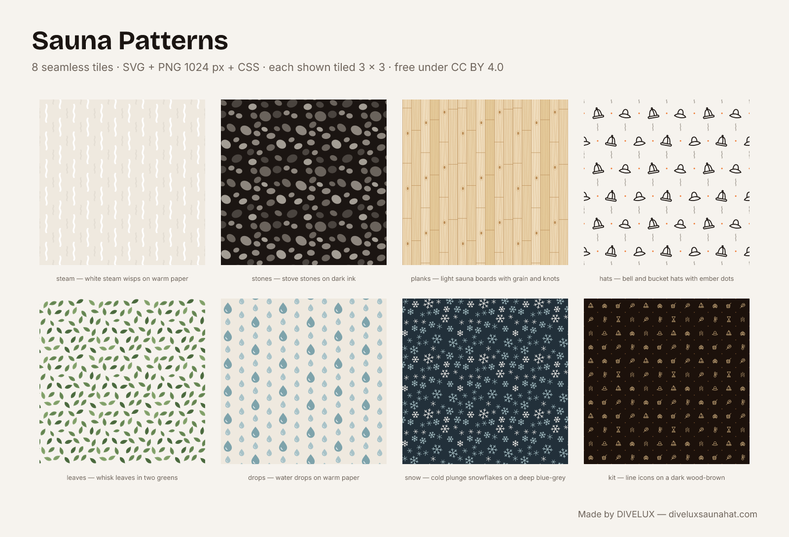

# Sauna Patterns

8 seamless vector patterns on a sauna theme: steam, stove stones, wood planks, sauna hats, birch leaves, water drops, snowflakes and a small-icon "kit" print. For web backgrounds, slides, packaging mockups, gift wrap, fabric and printables.

Made by DIVELUX, makers of handmade wool sauna hats — https://diveluxsaunahat.com



## What is inside

| Path | What it is |
|---|---|
| `svg/` | 8 tiles, 240 x 240 units, plain shapes |
| `png/` | the same tiles as 1024 x 1024 PNG |
| `patterns.css` | one class per pattern, for CSS backgrounds |
| `demo.html` | every pattern as a CSS background |
| `preview.png` | each tile repeated 3 x 3 |
| `src/build.py` | the source; also runs the seam test |
| `LICENSE` | CC BY 4.0 for the artwork, MIT for the code |

## Patterns

| Name | Looks like | Background |
|---|---|---|
| `steam` | white steam wisps | warm paper `#efe9df` |
| `stones` | stove stones | dark ink `#1b1512` |
| `planks` | light sauna boards with grain and knots | wood `#ecd6b2` |
| `hats` | bell and bucket sauna hats, ember dots | paper `#f6f3ee` |
| `leaves` | birch whisk leaves | paper `#f6f3ee` |
| `drops` | water drops | warm paper `#efe9df` |
| `snow` | snowflakes | blue-grey `#22303a` |
| `kit` | hat, stove, bucket, whisk, thermometer, timer, steam | dark brown `#1c110b` |

## How to use

CSS, with the bundled stylesheet:

```html
<link rel="stylesheet" href="patterns.css">
<section class="sauna-pattern sauna-pattern-steam">...</section>
```

Or one rule of your own:

```css
.hero {
  background: #efe9df url("svg/steam.svg") repeat;
  background-size: 240px 240px;   /* any size: the tile is vector */
}
```

The tile size is set with the `--sauna-tile` custom property (default `240px`): `style="--sauna-tile: 160px"`.

In Figma, Photoshop or Affinity, use a PNG tile as an image fill set to "Tile". For print, use the SVG.

## Seamless, checked

Every shape that crosses a tile edge is drawn again on the opposite side, so the tiles repeat without seams. `src/build.py` also checks the rendered pixels: it compares the first and the last pixel column and row of each 1024 px tile and counts places where a shape is cut off at the edge. All eight tiles pass.

## Rebuild

```
pip install resvg-py fonttools pillow numpy
python3 src/build.py
```

## License and credit

Free for personal and commercial use under [CC BY 4.0](https://creativecommons.org/licenses/by/4.0/). Please credit:

> Patterns by DIVELUX — diveluxsaunahat.com

More free sauna tools: https://diveluxsaunahat.com/pages/sauna-tools
